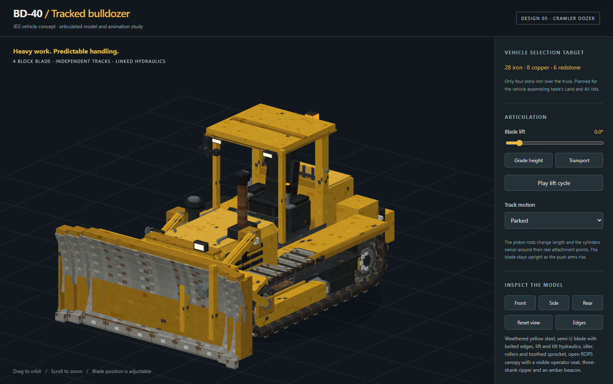

# BD-40 crawler bulldozer

A land-clearing machine for JEG, registered as `jeg:bulldozer`. Revision 05 includes the revised model,
controls, terrain work, sound and seated mirror. See [implementation status](IMPLEMENTATION_STATUS.md) for what is tested.



## Driving

The dozer drives with the same steered-track model as the truck and BMP-2.

| Key | Action |
| --- | --- |
| W / S | Throttle forward / reverse (top speed about 12 km/h, slower under load) |
| A / D | Steer; at a standstill the tracks counter-rotate and the machine pivots |
| Left Ctrl | Brake |
| Space / Left Shift | Raise / lower the blade |
| G | Grade lock. On by default: the blade stops at ground level. Off: Shift lowers it below grade and it cuts exactly one block down, then holds that level as the machine settles into its cut (HUD: "Cutting to Y"). Raise and lower again for the next level |
| R | Lower / raise the ripper. Lowered, it lays the blocks in the hold's Ripper bay (the last row, framed in amber) behind the machine |
| Left mouse button | Horn (a deep dual-tone industrial horn) |
| E, Left Alt | Hold (54 slots; the last row is the Ripper bay), dismount |

Releasing W/S stops the machine (hydrostatic drive), it does not coast. The diesel cranks for 1.7 s on boarding and
idles 4 s after the operator leaves.

The operator sits in an open ROPS canopy, visible from outside, and can look all the way round.

## Clearing land

Lower the blade and drive into the ground you want gone.

- Any block with hardness **10 or less** is cleared: soil, sand, gravel, stone, deepslate, ores, logs, leaves,
  plants and iron blocks. Obsidian, bedrock, block entities (chests, furnaces, signs), doors, beds, rails and
  anything in `#jeg:bulldozer_unbreakable` stop the blade.
- **What the blade takes above it:**
  - It always clears its face and the machine's own height (3 blocks), gaps or not, so it never leaves anything
    that would stop it.
  - Above that, it follows the bank stacked on what it cuts, up to 10 blocks above the cutting edge.
  - It crosses air pockets of up to 2 blocks (caves) only into natural ground (`#jeg:bulldozer_natural_ground`:
    stone, dirt, sand, ores...). Rock over a cave comes down, but a canopy, a building or rock over a bigger gap
    stays.
- The blade has limited power per tick. Under load the machine eases down to a steady crawl and picks up as the
  bite clears, instead of stopping and starting. It stops dead only against something it cannot cut. The HUD shows
  the load.
- **Trees fall whole.** When the blade meets a log, the break is presented to FallingTree as an axe stroke (the
  operator briefly holds a netherite axe and is not sneaking), so the pack's tree mod fells the tree. The dozer
  collects the wood into its hold. Without FallingTree, the dozer fells the connected trunk itself, but only when
  the tree has natural leaves, so log cabins are just cut where the blade meets them.
- Drops go into the hold. When it is full, common spoil (`#jeg:bulldozer_spoil`: dirt, cobblestone, sand, gravel,
  saplings...) is pushed aside (discarded); anything else drops at the blade.
- Above 22° the blade is carried for travel and does no work.
- **The ripper lays a surface.** On a real dozer the ripper breaks hard ground; here it is a paver.
  - Load the Ripper bay with full blocks: the hold's last row, 9 slots, up to 576 blocks. Lower the ripper with R
    and drive forward. It draws from the bay in slot order.
  - Across the lane behind the machine, the same columns the blade clears (5 blocks wide, or 4 when it runs exactly
    on the grid), the ground it runs on becomes that block. The old ground goes into ordinary cargo, and holes and
    water are filled.
  - Spoil never goes into the bay, and the bay takes only full blocks. The HUD shows what it is laying and how many
    are left across the bay.
  - Cut a level down with the blade and resurface it with the ripper in the same pass.
- Protection applies: world border, spawn protection, adventure mode and Fabric's `PlayerBlockBreakEvents` (claim
  mods).

## Model

- 125 bones, 1037 cuboids, 256×128 atlas.
- Long engine hood behind a cast radiator guard with grille, guard bars and recessed work lamps.
- Exhaust stack with an animated rain flap, and an air precleaner.
- Open ROPS canopy with a suspension seat, joysticks that move with the machine, dash and gauges.
- A tall, chamfered right mirror with a clamped mount, rubber bezel and blue-silver glass. Its angle is calculated
  from the operator's eye and a rearward sightline, clear of the canopy post. The glass is textured, not a live reflection.
- Fuel and hydraulic tanks, toolbox, three-shank ripper.
- Semi-U blade on C-frame push arms outside the tracks, with lift cylinders and tilt struts that track their pins.
- Running gear: idler, five bottom rollers, two carriers and a toothed sprocket, all turning at their real rolling
  radii, plus 30 articulated shoes per side.
- The chassis pitches under acceleration and braking, and shakes with engine speed. The blade chatters under load.

Generated by [generate.py](generate.py). It also writes the two LOD models, the texture and glow map, the paint mask
(yellow panels only), [rig.json](rig.json), the Blockbench project and the offline [preview](preview.html).
[verify_preview.py](verify_preview.py) checks the linkage, mirror angle and the entire glass's sightline, and exports the review images and the
selection icon. Edits made in Blockbench must be carried back into the generator.

Views: [raised blade](blade-raised.png), [side](side-profile.png), [front](front-view.png), [rear](rear-view.png).
In game: [operator view](in-game-operator-view.png), [looking back](in-game-look-behind.png),
[front](in-game-front.png), [clearing a bank](in-game-clearing.png), [felling a tree](in-game-tree.png),
[night](in-game-night.png), [seated mirror](in-game-mirror.png).
Ripper: [HUD](in-game-ripper-hud.png), [paving bay](in-game-ripper-bay.png),
[five-column lane off the grid](in-game-ripper-lane-off-grid.png), [four-column lane on the grid](in-game-ripper-lane-on-grid.png).

## Sound

Loops are static buffers, not streams: Minecraft has only about 8 streaming channels.

All field recordings of real machines are CC0 ([credits](../../src/main/resources/assets/jeg/sounds/vehicle/bulldozer/CREDITS.md)):

- **Diesel:** a close-miked Caterpillar crawler. Idle and working loops are cut from one take and crossfaded as one
  voice, with pitch following engine speed.
- **Distance:** a far-off working dozer takes over beyond about 40 blocks.
- **Machine:**
  - track clank whose rate follows track speed
  - soil and rock rolling off the blade, scaled by load
  - blade strikes
  - hydraulics
  - start-up and a shutdown run-down
  - a reversing alarm
- **Felling:** a real conifer creaking and crashing when a tree comes down.

The operator hears the machine centred in listener coordinates in first person and positioned in third person.
The same OpenAL channels keep playing across view changes; the first-person source stays centred while driving
and looking sideways, rather than following the camera a tick behind.

Rebuild the audio with [prepare_audio.py](prepare_audio.py) (numpy, scipy, soundfile). Levels and loop seams are
recorded in [audio-validation.json](audio-validation.json).

## Regenerate

```powershell
python design/bulldozer/prepare_audio.py   # only when changing audio
python design/bulldozer/generate.py
python design/bulldozer/verify_preview.py
```

[IMPLEMENTATION_PLAN.md](IMPLEMENTATION_PLAN.md) is the first iteration's plan, kept for history. Its controls and
clearing rules are superseded by this page.
