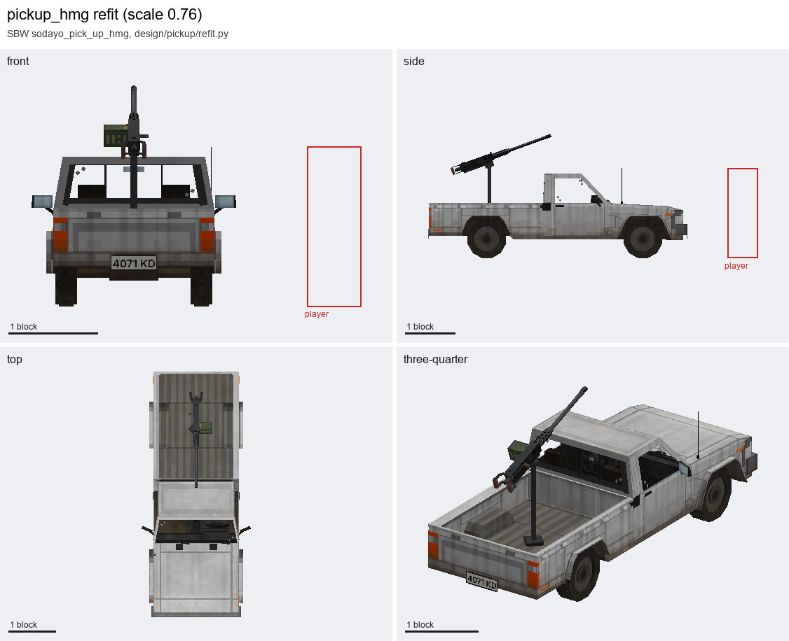

# 4x4 pickup and technicals

`jeg:pickup` and three technicals built on it: `jeg:pickup_hmg` (12.7 mm), `jeg:pickup_rocket` (107 mm rocket pod) and
`jeg:pickup_tow` (TOW). A single-cab 4x4 of the Land Cruiser 70 class, refit from Superb Warfare's pickups with the SBW
team's permission. See the [brief](BRIEF.md) for the design and [implementation status](IMPLEMENTATION_STATUS.md) for
what is played and tested.

## Seats

| Vehicle | Cab | Bed |
| --- | --- | --- |
| Pickup | driver, passenger | four riders along the sides |
| 12.7 mm | driver, passenger | the gunner, standing at the M2 |
| 107 mm | driver (lays and fires the pod from the cab), passenger | |
| TOW | driver, passenger | the gunner, standing at the sight |

## Keys

| Key | Action |
| --- | --- |
| W / S | Throttle / reverse (about 95 km/h flat out, the fastest land vehicle) |
| A / D | Steer (8.6-block circle from a crawl) |
| Left Ctrl | Brake |
| Mouse | Lay the weapon (gunner; the rocket technical's driver) |
| Left mouse button | Fire: the M2 bursts, the pod ripples top row first, the TOW launches and is steered by the sight |
| X / Z | Next / previous rocket (HE, AP, cluster) |
| B | Change seat |
| E | The hold: load rifle ammunition, 107 mm rockets or TOW missiles here |
| F5 | First person, chase camera, the hull's action camera |
| Left Alt | Dismount |

The cab doors swing open on their hinges while someone gets in or out of the cab, with a door's latch and slam. Lights
come on with the engine: headlamps with their beam at night, tail and brake lamps, reversing lamps.

## Behaviour

- **No armour** (rating 1.5, 140-150 hull): rifle rounds go through to the crew; the brief means it to be lost to one
  30 mm burst. A destroyed pickup cooks off and burns as a charred hulk.
- **Rocket pod:** lays from 10 to 60 degrees (at 10 a ripple clears the cab). The fire-control panel gives elevation,
  bearing and the range where the rockets come down. The backblast thins out near the chase camera.
- **TOW:** on a pedestal above the cab; wire-guided to 1,000 blocks.
- **Mobs** ride the cab's passenger seat and the bed; only crew drive.

## Regenerate

- Model, textures, LODs, hitbox rows and wheel data: fetch SBW's pinned sources with
  `python -I design/superbwarfare-port/fetch_sbw.py <sbw_dir> --pin 2026-11 sodayo_pick_up sodayo_pick_up_hmg sodayo_pick_up_rocket sodayo_pick_up_tow`,
  then `python -I design/pickup/refit.py <sbw_dir>` (`--dry` for rig.json and the review renders only).
- Sounds: `python -I design/pickup/prepare_audio.py` (CC0 recordings; credits in `sounds/vehicle/pickup/CREDITS.md`).
- Sandbox: `./gradlew runClientGameTest -PgameTests=ArmourSandboxSetup -PwithPack ...` rebuilds the ArmourTest world
  with the pickups in a row behind the armour (z -14).
