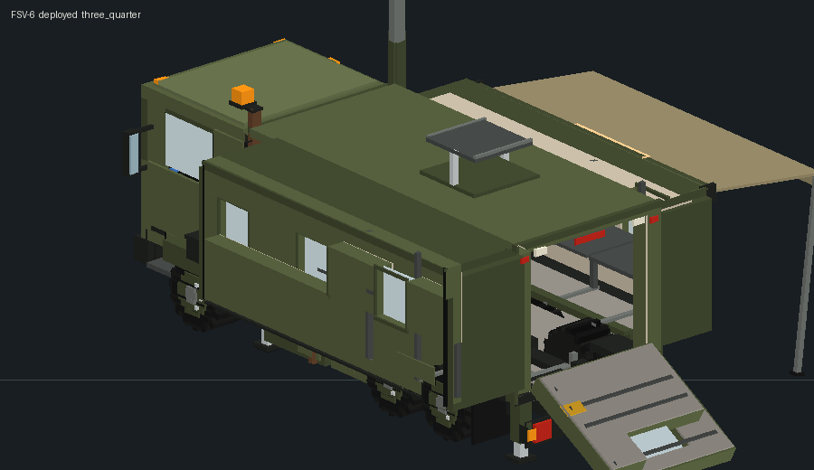

# FSV-6 field support vehicle

A base that drives, registered as `jeg:truck` (it replaces the old truck, which loads as an FSV-6 with its hold).
See the [plan](PLAN.md) for the design and [implementation status](IMPLEMENTATION_STATUS.md) for what is tested.



## Driving

| Key | Action |
| --- | --- |
| W / S | Throttle forward / reverse; it coasts when released (about 21 m/s flat out); S while rolling forward brakes (brake lights) |
| A / D | Steer (turning radius about 10 blocks at low speed) |
| Left Ctrl | Brake |
| R (hold 1 s, driver) | Deploy / pack up |
| Left mouse button | Air horn |
| N (driver) | Tow hitch: hitch the vehicle the panel offers, or drop the one in tow |
| E | The hold, with a Fit-out button |
| Left Alt | Dismount |

The diesel cranks for 1.5 s when the driver boards and idles 4 s after they leave. Lights come on at night.

**Wall panels.** In the room, the support console's panel shows the power source, battery, hold and room light on
its screen, with dials for battery, hold and generator load; the beacon terminal's panel shows the chosen effect's
icon, the level as four pips and four lamps, the beam pulsing while lit, and the rack. Both are live while the
generator runs.

**Instruments.** The driver's binnacle on the dash top, seen over the steering wheel, has a backlit tachometer and
speedometer with live needles, and eight warning lamps: brake, reverse, battery low, glow plug (cranking), roof beacons,
tow (blinking with a vehicle in reach, steady in tow), jacks out and engine running. The co-driver's dash has a green
status screen: battery, hold and body bars, the beacon's level and the tow lamp. They boot with the power and dim at
night.

## Deploying

Stop the vehicle within 10° of north, east, south or west and hold R. In eight seconds:
1. The jacks level the body, and it squares itself onto the block grid (at most half a block and 10°).
2. The slide-outs move out a block each side.
3. The rear door folds into a ramp and the awning unrolls.
4. The light mast swings up and telescopes, the beacon mount rises and the bunks fold down. The diesel stops and the
   generator takes over.

The room is then walk-in: 4 × 5 blocks, floor one block up, steps down the ramp. Invisible, unbreakable shell blocks
make its floor, walls, ceiling and steps (`VehicleShellBlock`); nothing can be built inside it.

It refuses, and the HUD says why and where, if:
- it is moving, or not squared up to a cardinal direction
- any cell of the room or its sweep is blocked, or in water
- the ground under a jack or the ramp's steps is out of reach
- someone or something stands where a slide-out goes
- the spot is protected (claims, spawn protection, world border, adventure mode)

Packing up is refused while anyone is inside.

## Fitting it out

The partition behind the cab carries two panels:
- **The support console** (right of the aisle): on the left, the fit-out plan, the vehicle from above with each
  fitting slot where that fitting is (bunks at the front, three bays down each side, the lamp mid-aisle, the roof
  beacon over the rear, the lockers outside the walls; empty slots show a faded picture of what they take). On the
  right, a status CRT (power, battery, body, room light, beacon, bunks, towing, the fitted modules) and a key to the
  hold. Right-clicking an empty bay, or sneak-right-clicking any bay, opens it too.
- **The beacon terminal** (left of the aisle): the beacon's state and level, its power rack and its effect keys.

Each module's own screen opens only by right-clicking that module in the room, one at a time. From the seats, the
hold screen shows the hold and one Fit-out button. Everything, beds included, can be added and removed while
deployed: a bed fitted appears in its bunk, one taken out disappears.
What fits where is set by the item tags `#jeg:support/*`, so a data pack can add more.

| Slot | Takes | Works |
| --- | --- | --- |
| 6 wall bays | chest or barrel (27 slots), ender chest, crafting table, furnace, smoker, blast furnace, brewing stand, anvil, stonecutter, smithing table, grindstone, loom, cartography table, enchanting table, jukebox, vehicle charging station | moving and deployed, except the jukebox, charging station and anvil's vehicle repair (deployed) |
| 2 bunks | a bed of any colour | deployed: a real bed (sleep, skip the night, set your spawn); change it any time |
| 2 outside lockers | chest or barrel | always: right-click the box under the body (olive door, yellow grab rail, ahead of the middle wheels). Looking at one says what is in it, or that it is empty and how to fit it |
| Roof mount | beacon | deployed, with the mast up; set at the beacon terminal |
| Room lamp (1) | lantern, sea lantern, froglight, glowstone, shroomlight, redstone lamp, end rod | hangs mid-room as the room's only light (its own light level), and lights the camp floodlights outside when deployed |

At the beacon terminal:

| Slot | Takes | Works |
| --- | --- | --- |
| Power rack (9 slots) | raw iron or gold, iron, gold, emerald, diamond or netherite blocks, or their ingots and gems (9 to a block) | sets the beacon level (9 / 34 / 83 / 164 blocks). Choosing an effect costs nothing: the rack is the price. An effect above the rack's level gives nothing |

- **Using modules:** right-clicking a fitted bay opens that block's own vanilla screen, with its sounds: chests,
  barrels and ender chests open and close, burning furnaces crackle, a finished brew chimes, the workstations sound as
  they do when used. Fitting a module or taking it out sounds as placing or breaking the block. Furnaces and brewing
  stands keep working while it drives.
- **Taking modules out:** a module that still holds things can't be removed.
- **Charging station:** recharges vehicles within 8 blocks from the FSV-6's battery, and rearms them, moving the
  ammunition their weapons use from this hold into theirs.
- **Anvil:** repairs vehicles within 8 blocks, one iron ingot from the hold per 10 points.
- **Beds:** players cannot break a bunk's bed. If something destroys one while deployed, the fitted bed is used up on
  pack-up, so beds are never doubled.
- **Respawning:** if you slept in a bunk and its bed is gone when you respawn (packed or driven off), you respawn
  beside the vehicle.
- **When it is wrecked:** everything fitted spills out, with its contents.
- **The crowbar:** packing the vehicle into a vehicle container keeps everything.

## Interior light

The fitted lamp is the room's only light. It hangs from the ceiling hook mid-room (its real 3D block model) and gives
the walk-in shell its own light level, a soft glow and a warm wash over the walls, bunks and bays. With no lamp fitted
the room is dark. The cream lining warms it by day. The awning's light strip and the mast floodlights glow outside
while the generator runs.

## Towing

Hitch the nearest empty vehicle within 7 blocks of the rear pintle, a wreck included, while packed:
- **From the driver's seat:** back up to it. The panel shows "N: hitch <vehicle>" with a pulsing lamp (and the tow
  lamp blinks on the dash); press N. Press N again to drop it.
- **On foot:** look at the back of the vehicle; the action bar shows "Sneak + Use: tow <vehicle>". Sneak and
  right-click. Do the same again to drop it.

It follows nose to the pintle. Towing ends if you deploy, if someone boards the towed vehicle, or if
it is pulled more than 16 blocks away. The tow bar itself is not drawn.

## Model

- 53 bones, about 720 cuboids, 256×128 atlas, 1:1 scale.
- A forward-control cab with two seats, a dash with the instrument binnacle and status screen, a turning steering
  wheel and mirrors.
- Six wheels on one-block tyres (10 px wide steer tyres in front, 9 px on the tandem), the front pair steering.
- The expansible van body: two slide-outs carrying bays and bunks, a rear door that becomes a ramp, an awning with legs,
  a telescopic light mast, a beacon mount, four stabiliser jacks that reach the ground, two amber beacons, a generator
  and lockers.

Generated by [generate.py](generate.py), which also writes:
- the two LODs, the texture and glow map, and the paint mask
- the fitted hitboxes for both poses (into `truck.json`: `obb` and `obb_deployed`)
- [rig.json](rig.json), the Blockbench project, and the review renders and selection icon

[render_eye.py](render_eye.py) renders the model from any point (a player's eye in the room) to check sightlines.
[make_cockpit.py](make_cockpit.py) draws the instruments' textures (dials, warning-lamp symbols, status screen).

## Sound

CC0 field recordings, listed in [credits](../../src/main/resources/assets/jeg/sounds/vehicle/truck/CREDITS.md):
- **Diesel:** idle and working loops from one take, crossfaded by engine speed.
- **Starting:** a synthesized starter motor that catches into the idle.
- **In the cab:** the diesel muffled through the cab in first person.
- **Far off:** the diesel's rumble with a ground echo.
- **No voices:** no asset carries a human voice (see the credits).
- **Deployed:** the generator.
- **Deploying:** the jacks' hydraulics, the slide-out motor, a synthesized air release and the ramp's clank.
- **Also:** an air horn and the reversing alarm.

Everything is heard on the aircraft's distance curve, delayed by distance and with Doppler, and carries past entity
range on the far tracks. Rebuild the audio with [prepare_audio.py](prepare_audio.py).

## Regenerate

```powershell
python design/support/prepare_audio.py   # only when changing audio
python design/support/generate.py
```
